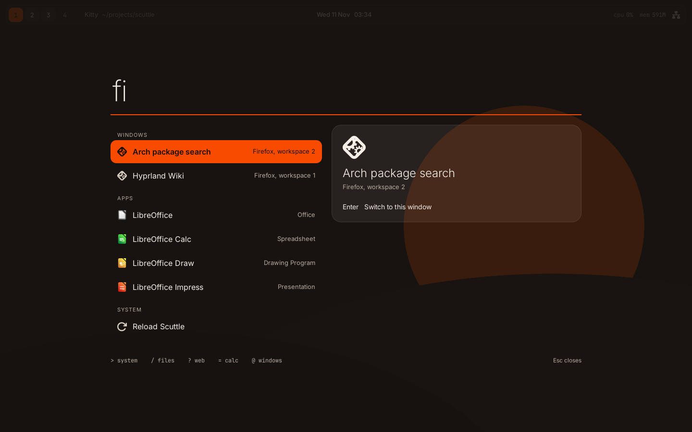
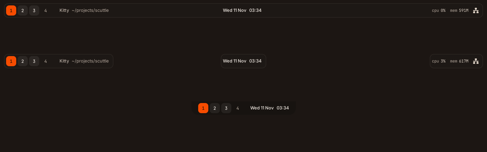

# Scuttle

A desktop shell for Hyprland on Arch Linux, written in Rust. One process draws the bar and the launcher, with the rest of the desktop (notifications, lock screen, settings, theming) on the way.



Scuttle exists because most Hyprland setups are five separate tools glued together with shell scripts: a bar, a launcher, a notification daemon, a power menu and a settings script, each with its own config format and its own look. Scuttle replaces that pile with one program, one config file and one visual style.

## What works today

Scuttle is early. This is what is built and tested right now.

**The bar.** Workspaces, the focused window's title, a clock, CPU load, memory use, network state and battery. It comes in three shapes: a full-width strip, three floating islands, or a small notch.



The battery widget only appears on machines that have a battery. A desktop PC never shows it, and a wireless mouse reporting its own charge does not count.

**The launcher.** One search box for apps, open windows, files, system actions, sums and the web. Results are grouped, the best group comes first, and what you use most rises to the top. Shut down, restart and log out ask for a second Enter before they run.

**Themes.** Four built-in themes, each in dark and light: `ferris` (orange on warm charcoal, the default), `tide`, `dune` and `bone`. Set any accent colour you like and Scuttle picks text colours that stay readable on it.

**Live config.** Save `config.toml` and the shell restyles itself. A mistake in the file is reported with the reason, and the previous settings stay in place.

**Battery awareness.** On a laptop running on battery, Scuttle turns blur off, caps animation and samples the system less often. Plug in and it all comes back.

## What is not built yet

Notifications, volume and brightness popups, the lock screen, the settings app, exporting the theme to GTK apps and terminals, the clipboard and emoji pickers, screen capture, the assistant panel, interface sounds, and the bar's media, volume and notification widgets. These are planned in roughly that order. Until then you still need a notification daemon such as mako.

## Install

Scuttle needs GTK 4 and gtk4-layer-shell, both in Arch's official repositories.

```sh
sudo pacman -S --needed gtk4 gtk4-layer-shell xdg-utils rust git
git clone https://github.com/Squandit/scuttle
cd scuttle
cargo build --release
sudo install -Dm755 target/release/scuttle /usr/local/bin/scuttle
```

Or build it as a package, which also installs the docs and example config:

```sh
cd packaging/arch
makepkg -si
```

The default fonts are Geist, Geist Mono and Sora. They are optional: without them Scuttle falls back to Inter, then to whatever sans-serif you have. On Arch they are in the AUR as `otf-geist`, `otf-geist-mono` and `ttf-sora`. Inter is in the official repos as `inter-font`.

## Set up Hyprland

Scuttle prints the lines your Hyprland config needs:

```sh
scuttle hyprland            # Hyprland 0.55 and newer (Lua config)
scuttle hyprland --legacy   # older Hyprland (hyprland.conf)
```

Add the output to your config. It does three things: starts Scuttle with the session, opens the launcher when you tap Super on its own, and tells Hyprland to blur what is behind Scuttle's panels.

If you already run Waybar, rofi or another bar or launcher, stop them first so you do not end up with two.

Scuttle also runs on other compositors that support layer-shell, such as Sway and niri. The workspace and window title widgets, and switching windows from the launcher, need Hyprland and are simply left out elsewhere.

## Using the launcher

Tap Super, type, press Enter. Escape closes it.

| Key | What it does |
| --- | --- |
| Up, Down, Tab, Shift+Tab | Move through the results |
| Ctrl+J, Ctrl+K, Ctrl+N, Ctrl+P | The same, without leaving the home row |
| Enter | Run the selected result |
| Escape | Close |

Start your search with one of these characters to search a single kind of thing:

| Prefix | Searches | Example |
| --- | --- | --- |
| `>` | System actions | `> lock` |
| `/` | Files | `/report` |
| `?` | The web | `? rust gtk4` |
| `=` | Calculator | `= 12 * (3 + 4)` |
| `@` | Open windows | `@wiki` |

You do not need the `=` for a sum. Type `12 * (3 + 4)` and the answer appears first; Enter copies it. Type a web address like `archlinux.org` and Enter opens it.

## The `scuttle` command

Running `scuttle` with no arguments starts the shell. Every other command talks to the shell that is already running.

```sh
scuttle toggle launcher     # open or close the launcher
scuttle launcher "> "       # open the launcher with text already typed
scuttle toggle bar          # hide or show the bar
scuttle reload              # re-read the config
scuttle config check        # check the config for mistakes
scuttle config example      # print the annotated example config
scuttle quit                # stop the shell
```

Bind any of these to keys in Hyprland.

## Configure

The config lives at `~/.config/scuttle/config.toml`. Every setting is optional. To start from the annotated defaults:

```sh
mkdir -p ~/.config/scuttle
scuttle config example > ~/.config/scuttle/config.toml
```

A few things people change first:

```toml
[appearance]
theme = "tide"        # ferris, tide, dune or bone
mode = "light"        # dark or light
accent = "#7c5cff"    # any colour
radius = 8            # corner radius in pixels
motion = "full"       # off, subtle or full

[bar]
style = "islands"     # strip, islands or notch
position = "bottom"   # top, bottom or none
right = ["cpu", "memory", "battery"]
```

With `position = "none"` there is no bar at all. The clock, battery and workspaces then show in the corners of the launcher whenever you open it.

[config/scuttle.example.toml](config/scuttle.example.toml) documents every setting.

## Privacy

Scuttle makes no network requests. The only thing it writes is a small file of which launcher results you have used and when, at `~/.local/share/scuttle/launcher-history`, so it can rank them. Delete the file to reset it.

## Development

The code is a Cargo workspace:

| Crate | What it holds |
| --- | --- |
| `scuttle-core` | Config, themes, the stylesheet generator, the control socket protocol |
| `scuttle-hypr` | Hyprland IPC client, plus a mock compositor for tests |
| `scuttle-launcher` | Search: app scanning, file index, calculator, matching and ranking |
| `scuttle-sys` | Battery, CPU, memory and network readings from `/sys` and `/proc` |
| `scuttle` | The GTK shell and the `scuttle` command |

Everything except the last crate is plain Rust with no GTK, and is covered by unit tests:

```sh
cargo test --workspace
cargo clippy --workspace --all-targets -- -D warnings
```

To run the shell without a display, `scripts/headless.sh` starts a headless Sway session with a mock Hyprland and takes screenshots. It needs `sway` and `grim`.

```sh
cargo build && cargo build -p scuttle-hypr --examples
scripts/headless.sh start
scripts/headless.sh ctl launcher "fire"
scripts/headless.sh shot /tmp/launcher.png
scripts/headless.sh stop
```

## License

MIT. See [LICENSE](LICENSE).
