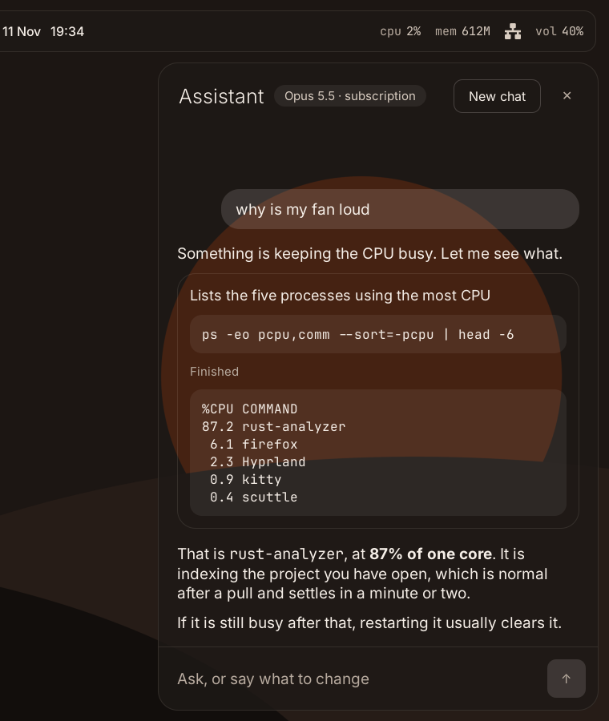

# Scuttle

A desktop shell for Hyprland on Arch Linux, written in Rust. One process draws the bar, the launcher, notifications and an assistant panel, with the rest of the desktop (lock screen, settings app, screen capture) on the way.


Scuttle exists because most Hyprland setups are five separate tools glued together with shell scripts: a bar, a launcher, a notification daemon, a power menu and a settings script, each with its own config format and its own look. Scuttle replaces that pile with one program, one config file and one visual style.

## What works today

Scuttle is early. This is what is built and tested right now.

**The bar.** Workspaces, the focused window's title, a clock, CPU load, memory use, network state and battery. It comes in three shapes: a full-width strip, three floating islands, or a small notch.


The battery widget only appears on machines that have a battery. A desktop PC never shows it, and a wireless mouse reporting its own charge does not count.

**The launcher.** One search box for apps, open windows, files, system actions, sums and the web. Results are grouped, the best group comes first, and what you use most rises to the top. Shut down, restart and log out ask for a second Enter before they run.

**Themes.** Four built-in themes, each in dark and light: `ferris` (orange on warm charcoal, the default), `tide`, `dune` and `bone`. Set any accent colour you like and Scuttle picks text colours that stay readable on it.

**One style across the desktop.** Scuttle works with [matugen](https://github.com/InioX/matugen), the tool dusky uses to colour GTK apps, terminals, Firefox and the rest from one palette. It goes both ways. Set `theme = "wallpaper"` and Scuttle takes its colours from matugen's palette, so it matches everything else and changes with the wallpaper. Or keep a built-in theme and run `scuttle theme push` to recolour everything else from Scuttle's accent. Either way, generated colours are checked for contrast and adjusted until text is readable.

**Live config.** Save `config.toml` and the shell restyles itself. A mistake in the file is reported with the reason, and the previous settings stay in place.

**Notifications.** Scuttle is its own notification daemon. Toasts slide in from a corner you choose, show the app's buttons, and pause their countdown while your pointer is on them. Critical ones stay until you dismiss them. A badge on the bar counts what you have not looked at, and do-not-disturb holds back everything except critical notifications.


**Now playing.** The bar shows the track from any player that supports MPRIS, which is nearly all of them: Spotify, Firefox and Chromium tabs, mpv, VLC and most music apps. Click to play or pause, scroll to skip. With several players open it shows the one that is playing. `scuttle media toggle`, `next` and `previous` do the same from the keyboard.

**Volume and brightness.** `scuttle volume up`, `down` and `mute`, and `scuttle brightness up` and `down`, change the level and show a small popup with the result. Bind them to your media keys; `scuttle hyprland` prints the lines. The bar has a volume widget you can scroll on to change the level and click to mute. Volume goes through `wpctl` and never past 100%. Brightness goes through systemd-logind, so it needs no extra setup or root.

**Interface sounds.** Soft, short tones when you open the launcher, move through results, run one, or hit an error. They are generated by Scuttle itself, so there are no sound files. By default they only play while your audio output is headphones or a headset, wired or Bluetooth, and stay silent on speakers. Set `sound.feedback` to `"always"` or `"never"` to change that.

**The assistant.** A side panel for asking Claude things and having it act on the desktop. It runs on your Claude subscription through the `claude` command, and switches to an API key when the subscription reaches its limit. It can change volume, brightness, playback and do not disturb itself. Anything else it proposes as a terminal command, which runs only after you press Run. See [The assistant](#the-assistant).



**Battery awareness.** On a laptop running on battery, Scuttle turns blur off, caps animation and samples the system less often. Plug in and it all comes back.

## What is not built yet

The settings app, screen capture, the keybind editor and the lock screen. The assistant cannot see the screen or read answers aloud yet. [docs/roadmap.md](docs/roadmap.md) has the details.

## Install

Scuttle needs GTK 4, gtk4-layer-shell and alsa-lib, all in Arch's official repositories.

```sh
sudo pacman -S --needed gtk4 gtk4-layer-shell alsa-lib xdg-utils rust git
git clone https://github.com/Squandit/scuttle
cd scuttle
cargo build --release
sudo install -Dm755 target/release/scuttle /usr/local/bin/scuttle
```

Or build it as a package, which also installs the docs and example config:

```sh
cd packaging/arch
makepkg -si
```

The clipboard mode needs `cliphist` and `wl-clipboard`, and the emoji picker needs an emoji font such as `noto-fonts-emoji`. All three are in the official repos.

Interface sounds use two optional packages you very likely already have on a PipeWire system: `pipewire-alsa` to play them and `libpulse` (for the `pactl` command) to tell headphones from speakers. Without them Scuttle is simply silent.

The assistant needs one of two things. To use a Claude subscription, install [Claude Code](https://code.claude.com/docs/en/setup) and run `claude` once to sign in. To use an API key, install `libsecret` (for the `secret-tool` command) and a keyring such as `gnome-keyring`, which dusky already has. Both together is best. Neither is needed if you do not use the assistant.

The default fonts are Geist, Geist Mono and Sora. They are optional: without them Scuttle falls back to Inter, then to whatever sans-serif you have. On Arch they are in the AUR as `otf-geist`, `otf-geist-mono` and `ttf-sora`. Inter is in the official repos as `inter-font`.

## Install on top of dusky

If you run [dusky](https://github.com/dusklinux/dusky), you do not need a fresh system. One script builds Scuttle and plugs it into dusky's own override folder, which dusky's updater never touches:

```sh
git clone https://github.com/Squandit/scuttle
cd scuttle
scripts/install-on-dusky.sh
```

Run it as your normal user from inside your Hyprland session. It asks for sudo once, only to install any missing packages. When it finishes, Scuttle is running and tapping Super opens the launcher.

What it changes:

- Adds `~/.config/hypr/edit_here/source/scuttle.lua` (autostart, the Super-tap key, Super + / for the assistant, blur rules) and one `require` line for it in `~/.config/hypr/edit_here/hyprland.lua`.
- Comments out the Waybar autostart line in `~/.config/hypr/edit_here/source/autostart.lua`, since Scuttle draws the bar.
- Disables the `mako` user service, since Scuttle shows notifications.

Everything else in dusky stays as it is. Your rofi menus and keybinds still work. dusky's volume and brightness keys still work too: they send their popup as a notification, and Scuttle draws it with a level bar. The installer leaves those keys bound to dusky's scripts so nothing fires twice.

`scripts/install-on-dusky.sh --keep-waybar` or `--keep-mako` leaves either one alone. `scripts/install-on-dusky.sh status` shows what is in place.

To go back to plain dusky:

```sh
scripts/install-on-dusky.sh uninstall
```

That removes the Hyprland file and the `require` line, restores the Waybar line, turns mako back on and starts Waybar again. Originals are also backed up in `~/.local/state/scuttle/dusky/backup`.

## Set up Hyprland

This section is for setups other than dusky.

Scuttle prints the lines your Hyprland config needs:

```sh
scuttle hyprland            # Hyprland 0.55 and newer (Lua config)
scuttle hyprland --legacy   # older Hyprland (hyprland.conf)
```

Add the output to your config. It starts Scuttle with the session, opens the launcher when you tap Super on its own, opens the assistant on Super + /, binds the volume, brightness and media keys, and tells Hyprland to blur what is behind Scuttle's panels and toasts.

If you already run Waybar, rofi or another bar or launcher, stop them first so you do not end up with two. The same goes for mako, dunst or swaync: while one of them is running it keeps the notifications, and Scuttle says so when it starts. To keep your current notification daemon on purpose, set `enabled = false` under `[notifications]`.

Scuttle also runs on other compositors that support layer-shell, such as Sway and niri. The workspace and window title widgets, and switching windows from the launcher, need Hyprland and are simply left out elsewhere.

## Using the launcher

Tap Super, type, press Enter. Escape closes it.

| Key | What it does |
| --- | --- |
| Up, Down, Tab, Shift+Tab | Move through the results |
| Ctrl+J, Ctrl+K, Ctrl+N, Ctrl+P | The same, without leaving the home row |
| Enter | Run the selected result |
| Escape | Close |

Start your search with one of these characters to search a single kind of thing:

| Prefix | Searches | Example |
| --- | --- | --- |
| `>` | System actions | `> lock` |
| `/` | Files | `/report` |
| `?` | The web | `? rust gtk4` |
| `=` | Calculator | `= 12 * (3 + 4)` |
| `@` | Open windows | `@wiki` |
| `;` | Clipboard history | `;token` |
| `:` | Emoji | `:fire` |

Clipboard history comes from [cliphist](https://github.com/sentriz/cliphist), which dusky and most Hyprland setups already run. Enter puts the chosen entry back on the clipboard. Scuttle keeps no copy of its own. The emoji picker knows all 1,900 emoji by name and learns which ones you use.

You do not need the `=` for a sum. Type `12 * (3 + 4)` and the answer appears first; Enter copies it. Type a web address like `archlinux.org` and Enter opens it.

## The assistant

Open it with Super + /, or `scuttle toggle assistant`. Type a question and press Enter. Shift+Enter starts a new line, and Esc closes the panel. `scuttle ask why is my fan loud` opens it and sends the message in one go, which is handy from a terminal or a keybind.

**How it reaches Claude.** There are two ways, and Scuttle uses whichever you have set up.

- Your Claude subscription, through the `claude` command from Claude Code. This is tried first and uses Opus 5.5.
- An API key, using Haiku 5.5. Store one with `scuttle assistant set-key`.

With both set up, the subscription answers until it reports that its usage limit is reached. The API key then takes over, the header shows that it has, and Scuttle goes back to the subscription when the limit resets. `scuttle assistant status` shows what is set up. To use only one, or to change either model:

```toml
[assistant]
backend = "auto"                        # auto, subscription or api
subscription_model = "claude-opus-5-5"
api_model = "claude-haiku-5-5"
side = "right"                          # or left
```

**What it can do without asking.** Twelve things, all of them Scuttle's own commands: volume up, down and mute, brightness up and down, play or pause, next and previous track, do not disturb on and off, dismiss notifications, and hide or show the bar. Each one shows in the conversation as it happens. The list is fixed in the code, so the assistant cannot run anything else this way.

**What it has to ask for.** Everything else is a terminal command, shown in a card with the reason, the exact command, and Run and Skip buttons. Nothing runs until you press Run or Ctrl+Enter. The command runs without a terminal, so it cannot prompt for a password, and it is stopped after a minute. What it printed is shown in the card and sent back to Claude, which then tells you what it means. That is how a question like "why is my fan loud" gets a real answer: Claude asks to run `ps`, you allow it, and it reads the result.

Read a command before you run it. Scuttle shows it exactly as it will run, but it does not judge whether it is a good idea.

**Your API key.** It is kept in the system keyring, through `secret-tool`. It is never written to `config.toml`, never logged, and never passed on a command line. `scuttle assistant clear-key` removes it. If you have no keyring, Scuttle reads `ANTHROPIC_API_KEY` from the environment instead.

**What it cannot do yet.** It cannot see your screen or read files. It knows what you type and the output of commands you ran from it. Each time Scuttle starts, the conversation starts empty.

To turn the assistant off, set `enabled = false` under `[assistant]`.

## The `scuttle` command

Running `scuttle` with no arguments starts the shell. Every other command talks to the shell that is already running.

```sh
scuttle toggle launcher     # open or close the launcher
scuttle launcher "> "       # open the launcher with text already typed
scuttle launcher ";"        # open clipboard history
scuttle launcher ":"        # open the emoji picker
scuttle toggle assistant    # open or close the assistant panel
scuttle ask why is my fan loud   # open the assistant and ask
scuttle assistant status    # show how the assistant reaches Claude
scuttle assistant set-key   # store an API key in the keyring (also: clear-key)
scuttle toggle bar          # hide or show the bar
scuttle dnd                 # toggle do not disturb (or: dnd on, dnd off)
scuttle dismiss             # dismiss every notification on screen
scuttle media toggle        # also: next, previous
scuttle volume up           # also: down, mute, and --by 10 for bigger steps
scuttle brightness down     # also: up
scuttle theme show          # print the colours in use and where they come from
scuttle theme push          # recolour other apps to match, through matugen
scuttle reload              # re-read the config
scuttle config check        # check the config for mistakes
scuttle config example      # print the annotated example config
scuttle quit                # stop the shell
```

Bind any of these to keys in Hyprland.

## Configure

The config lives at `~/.config/scuttle/config.toml`. Every setting is optional. To start from the annotated defaults:

```sh
mkdir -p ~/.config/scuttle
scuttle config example > ~/.config/scuttle/config.toml
```

If everything looks too small or too big on your screen, change `scale`. It resizes the bar, the launcher, text and spacing together, and applies as soon as you save:

```toml
[appearance]
scale = 1.5           # 1.0 is the base design size, the default is 1.25
```

A few other things people change first:

```toml
[appearance]
theme = "tide"        # ferris, tide, dune or bone
mode = "light"        # dark or light
accent = "#7c5cff"    # any colour
radius = 8            # corner radius in pixels
motion = "full"       # off, subtle or full

[bar]
style = "islands"     # strip, islands or notch
position = "bottom"   # top, bottom or none
right = ["cpu", "memory", "battery"]
```

With `position = "none"` there is no bar at all. The clock, battery and workspaces then show in the corners of the launcher whenever you open it.

[config/scuttle.example.toml](config/scuttle.example.toml) documents every setting.

## Privacy

Scuttle has no telemetry and makes no network requests of its own, with one exception you control: the assistant. When you send it a message, the conversation goes to Anthropic, either through the `claude` command or straight to `api.anthropic.com` with your API key. That includes the output of any command you ran from the panel. Nothing is sent until you send a message, and with `enabled = false` under `[assistant]` nothing ever is.

Conversations are kept in memory only and are gone when Scuttle stops. The `claude` command keeps its own session history under `~/.claude`, as it does when you use it in a terminal.

The only thing Scuttle writes is a small file of which launcher results you have used and when, at `~/.local/share/scuttle/launcher-history`, so it can rank them. Delete the file to reset it.

## Development

The code is a Cargo workspace:

| Crate | What it holds |
| --- | --- |
| `scuttle-core` | Config, themes, the stylesheet generator, the control socket protocol |
| `scuttle-hypr` | Hyprland IPC client, plus a mock compositor for tests |
| `scuttle-launcher` | Search: app scanning, file index, calculator, matching and ranking |
| `scuttle-sys` | Battery, CPU, memory and network readings from `/sys` and `/proc` |
| `scuttle-sound` | Synthesised interface sounds, playback and headphone detection |
| `scuttle-media` | Now playing and playback control over MPRIS |
| `scuttle-notify` | The notification D-Bus service and the rules for showing and keeping notifications |
| `scuttle-assistant` | The assistant: both ways of reaching Claude, the switch between them, actions, and running approved commands |
| `scuttle` | The GTK shell and the `scuttle` command |

Everything except the last crate is plain Rust with no GTK, and is covered by unit tests:

```sh
cargo test --workspace
cargo clippy --workspace --all-targets -- -D warnings
```

To run the shell without a display, `scripts/headless.sh` starts a headless Sway session with a mock Hyprland and takes screenshots. It needs `sway` and `grim`.

```sh
cargo build && cargo build -p scuttle-hypr --examples
scripts/headless.sh start
scripts/headless.sh ctl launcher "fire"
scripts/headless.sh shot /tmp/launcher.png
scripts/headless.sh stop
```

## Matching the rest of your desktop

There are two ways to get Scuttle and your other apps into one colour scheme. Both need matugen, which dusky already has set up.

**Scuttle follows the wallpaper.** Put this in `~/.config/scuttle/config.toml`:

```toml
[appearance]
theme = "wallpaper"
```

Scuttle then reads the palette matugen generated from your wallpaper and restyles itself every time that palette changes. `scuttle theme show` tells you which palette file it found.

**Everything follows Scuttle.** Keep a built-in theme such as `ferris`, then run:

```sh
scuttle theme push
```

That hands Scuttle's accent colour to matugen, which recolours every app it themes. It lasts until you next change the wallpaper through your usual tool, which recolours from the wallpaper again. Using the wallpaper in this repo with the `ferris` theme gets you close to the same result without pushing.

## Wallpaper

The wallpaper in the screenshots is in the repo at [assets/wallpapers/ferris.png](assets/wallpapers/ferris.png), 3840x2160. It matches the default `ferris` theme.

## License

MIT. See [LICENSE](LICENSE).
